<div align="center">

# Marketing Studio

**Google Ads, Meta, Email, SEO and social in one Mac app. Every change goes into a draft first, and nothing goes live until you press Push.**


-3776AB)


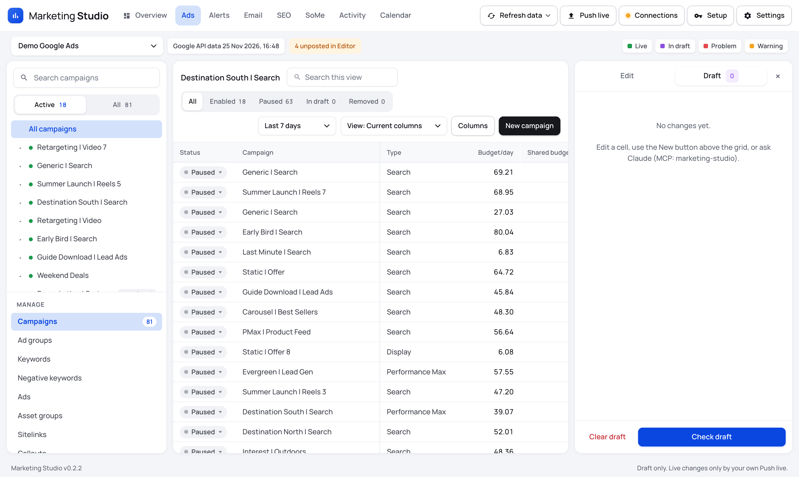

<sub>All screenshots use anonymised demo data: names, numbers, images and IDs are replaced.</sub>

</div>

---

## Contents

| | |
|---|---|
| **Start** | [What it is](#what-it-is) · [Install](#install) · [First run: Setup](#first-run-setup) · [Updates](#updates) |
| **Using it** | [The window](#the-window) · [Ads](#ads-google-ads-and-meta) · [Draft and Push](#the-draft-and-push-live) · [Overview](#overview) · [Email](#email) · [SEO](#seo) · [SoMe](#some) · [Activity](#activity) · [Calendar](#calendar) · [Keyboard](#keyboard) |
| **Connections** | [Meta](#meta) · [Google Ads](#google-ads) · [Google sign-in](#google-sign-in) · [Email platform](#email-platform) · [WordPress](#wordpress) · [LinkedIn](#linkedin) · [.env import](#import-keys-from-a-env-file) |
| **Claude** | [Use with Claude Code (MCP)](#use-with-claude-code-mcp) · [MCP tools](#mcp-tools) |
| **Under the hood** | [How it works](#how-it-works) · [Where your data lives](#where-your-data-lives) · [Data refresh policy](#data-refresh-policy) · [Safety rails](#safety-rails) · [Privacy](#privacy) |
| **Developers** | [Run from source](#run-from-source) · [Tests](#tests) · [Build the app](#build-the-app) · [Release](#release) · [Repository layout](#repository-layout) · [Troubleshooting](#troubleshooting) · [License](#license) |

---

## What it is

Marketing Studio works the way Google Ads Editor does, for **Google Ads and Meta (Facebook + Instagram) together**,
and it also has areas for **Email, SEO and organic social**.

- **Everything in one grid.** Campaigns, ad groups or ad sets, ads, keywords, audiences, assets, with stats for any period.
- **Edit, and it goes into the draft.** There is no Save button: each change is saved to the draft about a second after you stop typing.
- **Push when you are ready.** Push shows a short summary ("Ad sets edited 3, Ads added 1"), the platform checks every change, then **Push live** sends it, with a progress bar per change.
- **Undo.** Every push is logged with the values from before the push, so you can reverse it from **Push history**.
- **Claude can help.** Studio ships an MCP server: Claude Code can read your accounts and add changes to the same draft. Only you can push.

It is a small native Mac app around a local engine that only listens on `127.0.0.1`. Your keys stay on your Mac, in the macOS Keychain.

---

## Install

1. Download **`MarketingStudio-macOS-arm64.zip`** from the [latest release](https://github.com/Sivertsen0007/MarketingStudio/releases/latest).
2. Unzip it and drag **Marketing Studio.app** into **Applications**.
3. The first time: **right-click the app > Open**, then **Open** again. The app is signed with our own certificate,
   not an Apple Developer ID, so macOS asks once. (Or: System Settings > Privacy & Security > **Open Anyway**.)

**Requirements**

| | |
|---|---|
| macOS | 13 Ventura or newer, Apple Silicon |
| Python 3 | Comes with the Xcode Command Line Tools: `xcode-select --install` (Studio uses only the standard library) |
| Google Ads Editor | Optional. Only for *Send to Editor* and for reading Editor's local copy of an account |

---

## First run: Setup

Setup opens by itself the first time. Later you open it with the **Setup** button at the top.

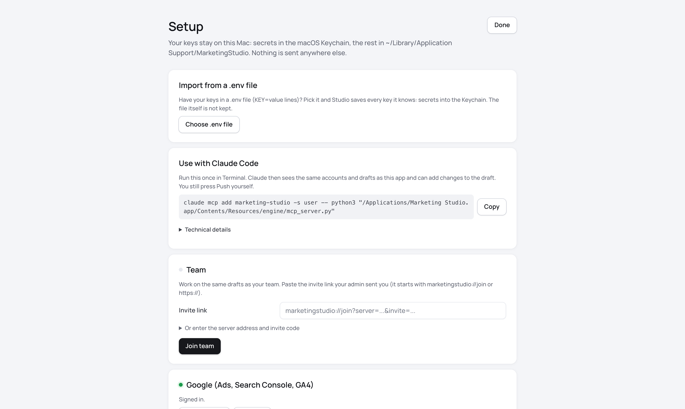

Fill in only what you use. Each block shows a green dot once it has keys.

| Block | What it is for |
|---|---|
| **Import from a .env file** | Load all your keys at once from a `KEY=value` file ([details](#import-keys-from-a-env-file)) |
| **Use with Claude Code** | The one line that connects Claude Code to Studio, with a Copy button ([details](#use-with-claude-code-mcp)) |
| **Google** | Sign in with Google for Google Ads, Search Console and GA4 |
| **Meta** | Access token, ad account id, Page id |
| **Google Ads** | Developer token, manager account (MCC) id, default account id |
| **Google sign-in** | The OAuth client id and secret used by *Sign in with Google* |
| **Email** | Your email platform: Email API URL + token and/or MCP URL + token, sender, test address, timezone |
| **WordPress (SEO)** | User and application password, for publishing SEO edits |
| **LinkedIn** | Access token and organisation URN (optional) |
| **Advanced** | Folder for *Save HTML to folder*, and an optional R2 image library for uploading SoMe media |

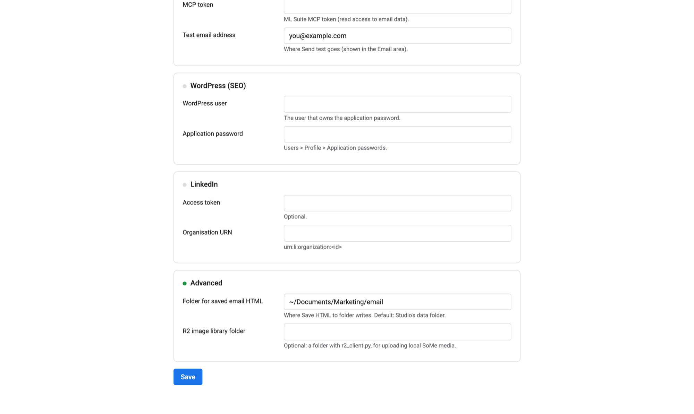

Secret fields never show their value again. They say *Saved - type to replace*, and **Remove** deletes the key from the Keychain.

---

## Updates

Marketing Studio updates itself from this repository's GitHub Releases.

- It checks when it starts and then once a day. When a newer version exists, a banner says **Update available: vX.Y.Z - Update now**.
- **Update now** downloads the release and checks two things: that it is exactly the file GitHub published (SHA-256), and that it is
  signed with **the same certificate** as the app you have. Then it swaps the app and restarts. If anything fails, your old version stays.
- Your drafts, history and keys are not touched by an update: they live outside the app (see [Where your data lives](#where-your-data-lives)).

The version you run is shown bottom left (*Marketing Studio v0.1.2*).

**Which copies get updates**

| How you got it | Updates |
|---|---|
| Downloaded the zip from [Releases](https://github.com/Sivertsen0007/MarketingStudio/releases/latest) | Yes, in the app (banner + Update now) |
| Built it yourself from the source (`./build.sh`), or from a fork | No. Your build is signed with a different certificate, so the app refuses our releases and says to update by hand: `git pull` and build again, or switch to the release download |
| Running the engine from source (`python3 server.py`) | No updater: `git pull` gets the latest code |

The certificate check is on purpose: an update is only installed when it is signed by the same certificate as the app you already
have, so nobody else can push code into your copy.

---

## The window

| Part | What it does |
|---|---|
| **Overview** (top left) | Switches between the dashboard and the editor |
| **Ads · Email · SEO · SoMe · Activity** | The five areas |
| **Account picker** | Google Ads accounts and Meta ad accounts. Meta accounts can be added in Settings |
| **↻** | Re-reads the current account from the API |
| **Refresh data ▾** | Fetch again per source: one Google account, one Meta account, Email, SEO, SoMe, Activity, rates, or all |
| **Push** | Turns blue with a count when the draft has changes. Opens the push summary |
| **Connections** | Read-only health check of every connection (tokens, API versions, access, rate limits) |
| **Setup** | Keys and sign-in |
| **Settings** | Saved views, Meta ad accounts, display currency, data refresh |
| **Legend** | *Live*, *In draft*, *Problem*, *Warning*: the colours you see in the grid |

The app opens full-size and remembers its window. The standard Edit menu works (copy, paste, undo, find), **Cmd+R** reloads,
and links open in your normal browser.

---

## Ads: Google Ads and Meta

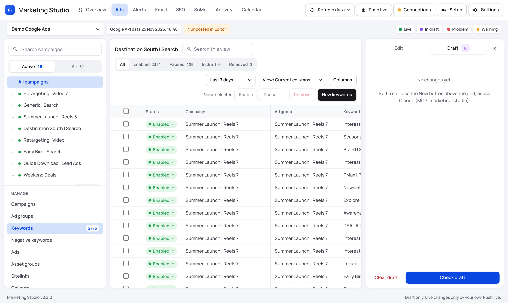

**Left: the tree.** All campaigns, open one for its ad groups (Google) or ad sets (Meta). Search filters it. Under **MANAGE** you
pick what the grid shows:

| Google Ads | Meta |
|---|---|
| Campaigns, Ad groups, Keywords, Negative keywords, Ads (RSA + DSA), Asset groups (PMax), Sitelinks, Callouts, Snippets, Prices, Promotions, Locations, Audiences, Shared lists, Recommendations | Campaigns, Ad sets, Ads, Audiences, Lead forms (read-only) |

**Middle: the grid.**

- **Status pills** (All / Enabled / Paused / In draft / Removed or Live now) filter the rows.
- **Search this view**, **date range** (7, 14, 30, 90 days or custom) for the stats columns.
- **Views**: built-in *Data* and *Edit* views per grid, plus your own (Settings). **Columns** picks and orders columns; columns can also be dragged.
- **Status and amounts** (budget, max CPC) are edited right in the cell. Select rows for **Enable / Pause / Remove** in bulk.
- **+ Add**: new campaign, ad group, keywords, negatives, callouts, sitelinks, excluded locations, PMax assets, audiences, shared lists,
  responsive search ads; on Meta new campaigns, ad sets, ads (image or video), carousel and multi-text copy.
- Rows in the draft are tinted: the old value struck through, the new one next to it.

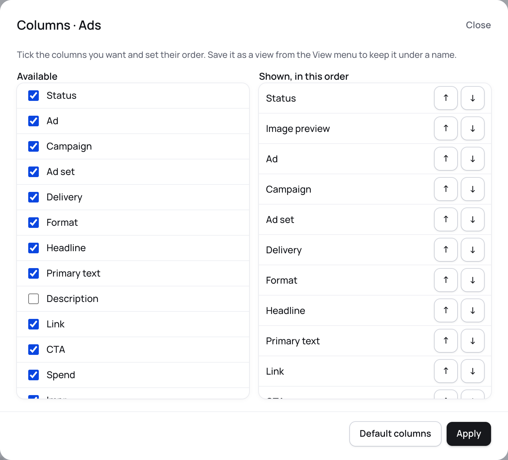

**Right: Edit panel.** Click a row and it opens on the right.

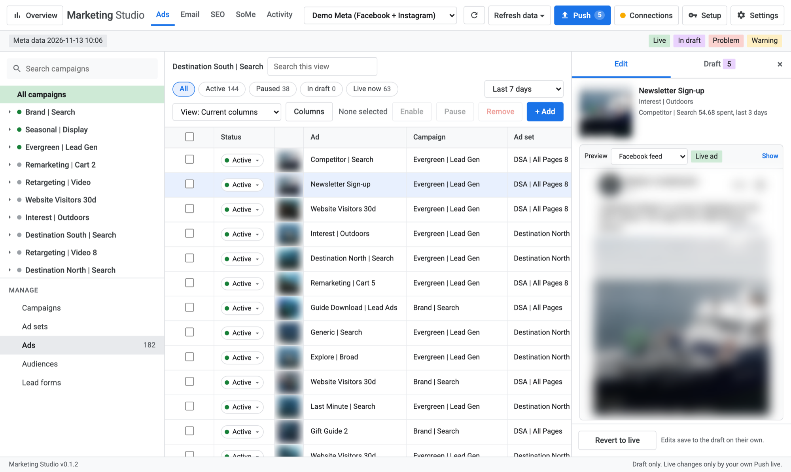

- **Meta ads:** status, name, primary text, headline, description, link, call to action. Ads with several text options
  (Advantage+ creative) show every option. Carousels show every card.
- **Preview:** Meta's own rendering of the ad (Facebook feed, Instagram feed, Stories, Reels, desktop). It loads by itself, shows
  *With your changes* when you have edited the copy, and the next few ads are fetched ahead so arrowing down is instant.
- **Meta ad sets:** status, name, daily budget, countries, age, end date, placements (Advantage+ or pick platforms and positions).
- **Meta campaigns:** status, name, campaign budget.
- Thumbnails get bigger when you hover them.

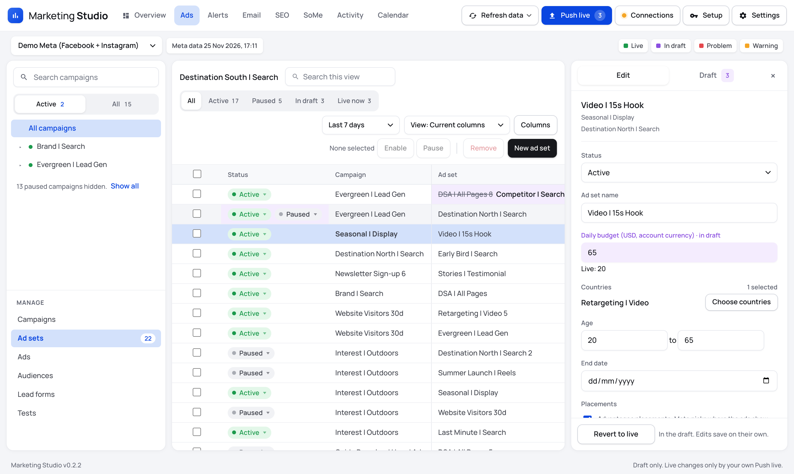

There is no Save button. About a second after you stop typing, the change is in the draft (*Saving ... → Saved to draft*).
**Revert to live** removes that row's changes from the draft.

---

## The draft and Push live

**The Draft tab** lists every change: who made it (*You* or *Claude*), when, what, and any problems or warnings. **Undo** removes
one change. **Check** re-runs every check. **Clear** empties the draft.

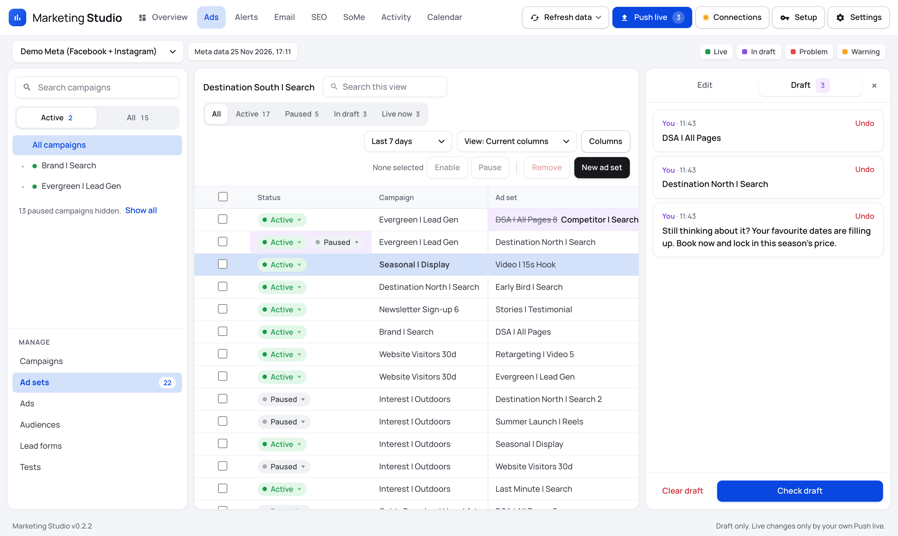

**Push** (top bar) opens a short summary of the whole draft, the way Google Ads Editor does:

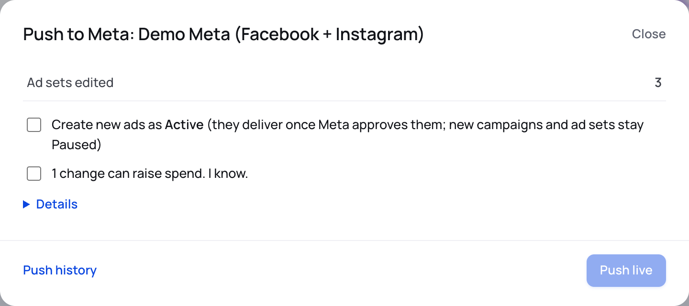

- The platform has already checked every change (Google *validateOnly*, Meta *validate_only*). Nothing has changed yet.
- Changes that can **raise spend** (enabling, a bigger budget, wider targeting) and **permanent** ones (removals in Google Ads) need a tick first.
- **Details** shows each change with before → after, if you want it.
- Google: **Send to Editor instead** writes the draft into Google Ads Editor as pending changes, so you post it from there.
- **Push live** shows progress per change and ends with **Everything is live.**

| | Google Ads | Meta |
|---|---|---|
| How it is sent | One request: all of it goes live or none of it | One change at a time; if Meta refuses one, the ones already done are reversed |
| New objects | Campaigns always **paused**; ad groups, keywords and ads paused unless you tick *create as enabled* | Campaigns, ad sets and ads always **paused** |
| Copy changes | RSA headlines and descriptions are replaced | A new creative with the same image or video; the ad goes back to Meta review |
| Deleting | Removals are permanent in Google Ads (flagged) | Studio never deletes or archives anything that existed before |

**Push history** (link in the Push window) lists earlier pushes with what changed. **Undo** puts the values from before the push back.

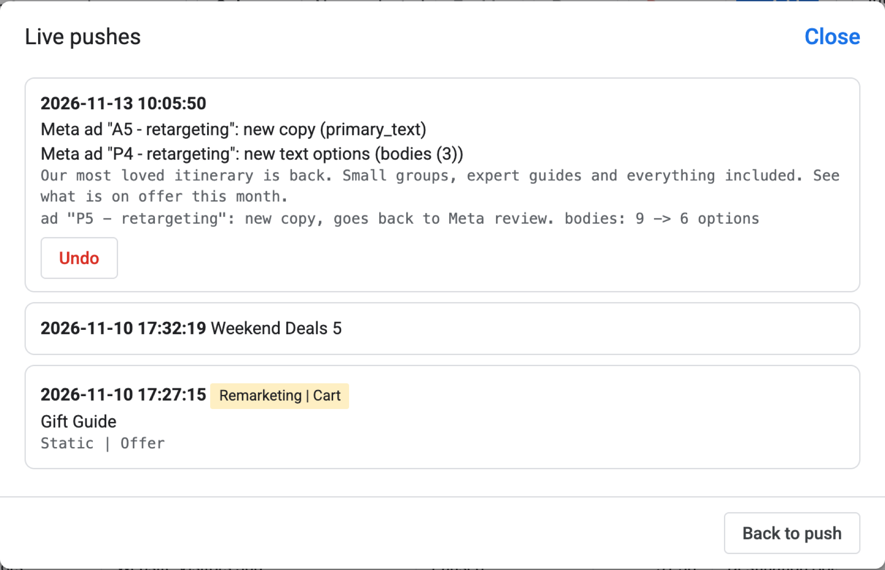

Not everything can be undone automatically: removed keywords, ads or ad groups in Google Ads, and bid strategy switches. The history says so.

---

## Overview

The **Overview** button gives a dashboard for the chosen period: spend, clicks, results, key events and cost per key event for each
ad platform; email campaigns, opens and clicks; organic clicks, impressions, position and top mover from Search Console; posts,
reach and engagement from social. Below: spend by destination and every campaign with spend.

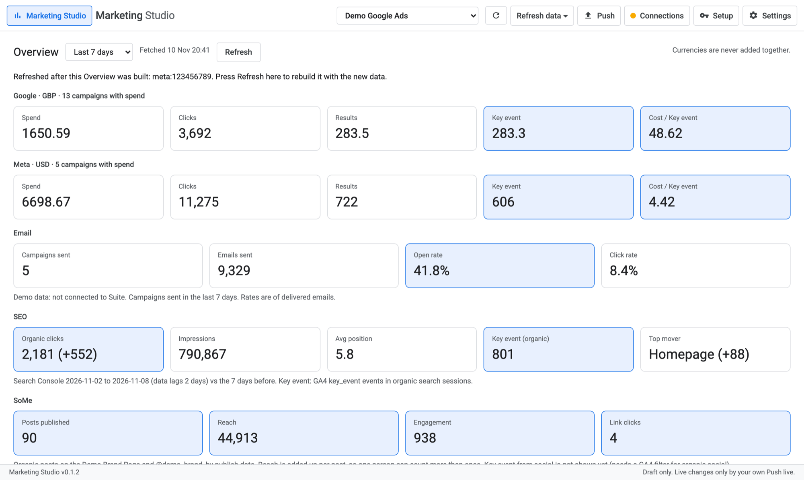

Currencies are never added together. Set a **display currency** in Settings to see converted figures next to the original ones
(ECB rates). Drafts and pushes always use each account's own currency.

---

## Email

The Email area works with **your email platform**, through the [Email API](#email-api-contract) or the platform's
[MCP server](#mcp-contract). Without a connection it shows demo data and sends nothing.

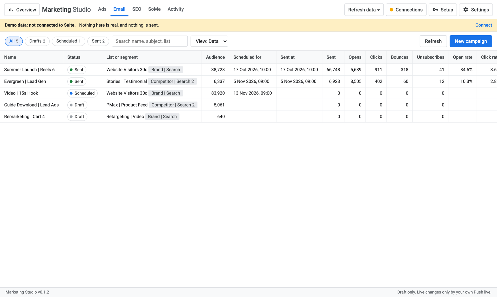

- The list: name, status, list or segment, audience, schedule, sent, opens, clicks, bounces, unsubscribes, rates.
- Open a draft to edit name, subject, preview text, from name, audience and the HTML. The preview updates as you type
  (desktop and mobile), and your edits are kept as a Studio draft on their own.
- **Check** runs every check: subject length, links (each one is fetched), merge tags, images, the sender, and your own copy rules.
- Then your own buttons: **Save to platform**, **Send test** (to your test address), **Schedule**, **Send now**, **Cancel schedule**.
- **Save HTML to folder** writes the HTML to the folder set in Setup > Advanced.
- **Right-click** a campaign to open it or delete a draft (with a confirm step). Sent and scheduled campaigns can't be deleted.

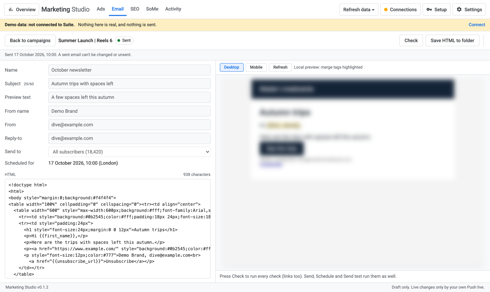

| Connected through | What you can do |
|---|---|
| **Email API** | Everything: read, edit, save, test, schedule, send, cancel |
| **MCP** | Read campaigns, stats and audiences, and create new drafts |
| Nothing | Demo data, nothing is sent |

When both are set up, Studio uses the Email API and falls back to the MCP if the API does not answer.

**Your own copy rules.** Put a file `email_copy_rules.json` in Studio's data folder
(`~/Library/Application Support/MarketingStudio/data/`) and Check flags them in subjects, preview texts and the visible text:

```json
[
  {"level": "error", "pattern": "\\bguaranteed?\\b", "message": "No promises (\"guaranteed\")."},
  {"level": "warn",  "pattern": "\\bcheap\\b",       "message": "Say \"great value\", not \"cheap\"."}
]
```

Studio only reads counts and list or segment names, never subscriber rows or addresses. Any address that is not on your own
domains is removed before it is shown or cached.

## SEO

The SEO area combines the WordPress blog with **Search Console** and **GA4**.

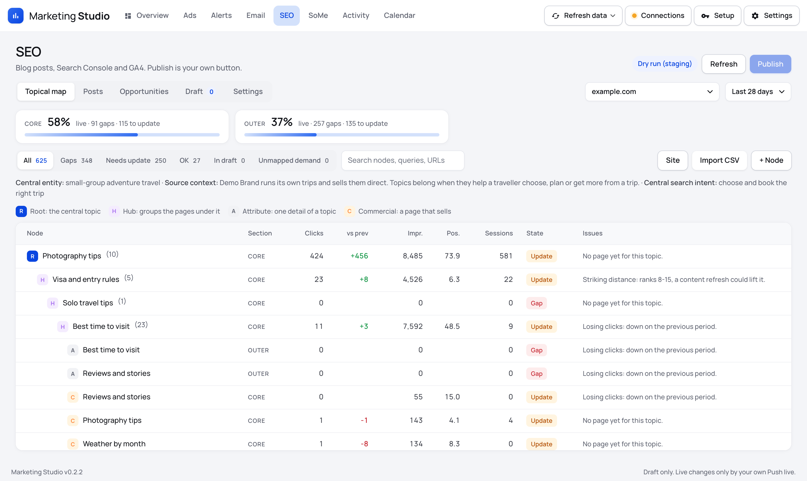

- **Posts:** every post with words, clicks, impressions, CTR, average position, change against the previous period, organic sessions,
  key events and internal links in and out. Filter by losing clicks, not indexed, in draft.
- **Opportunities:** posts losing clicks, low CTR, queries in striking distance, pages not indexed.
- **Edit view:** SEO title, meta description, focus keyphrase (Yoast) and content, with checks on length and links.
- **Draft → Publish:** edits are drafted first. **Publish** writes them to WordPress (with a dry run until a WordPress application
  password is set). Every publish can be undone.

### Topical map

The **Topical map** tab plans the site the Koray way and joins every page with Search Console and GA4, so you see what is
missing and what needs work in one place.

- **Site anchor:** the *central entity* (what the whole site is about), the *source context* (who you are and why you publish,
  which decides what belongs) and the *central search intent* (the user's underlying purpose).
- **Nodes:** each planned page sits in a tree (root, hubs, attribute pages, commercial pages), in the **core** section (what the
  source context sells) or the **outer** section (the attributes that build authority). A node holds its entity and attribute,
  macro context, target queries, intent, priority, URL and the pages it must link to.
- **Numbers and issues per node:** clicks, impressions, CTR, position, change against the previous period, sessions and key
  events, and what to do: *gap* (no page yet, or no page behind the URL), *update* (losing clicks, positions 8-20, low CTR,
  not indexed, a target query landing on another page, missing internal links the map asks for).
- **Coverage** per section and **Unmapped demand**: Search Console queries whose pages have no node yet.
- **Import CSV** brings in an existing topical-map sheet (columns are matched loosely: title, parent, URL, keywords, type,
  priority ...). **+ Node** and the side panel edit the map by hand.
- **Claude builds it with you:** over MCP, Claude reads the map and the gaps and *proposes* changes. A proposal shows at the top
  of the tab; nothing changes until you **Accept**.
- **Pages, straight from the map:** every node is connected to its WordPress post. Open a node and press **Edit text** to edit
  the post (title, SEO title, meta description, body with live preview). A node with no page gets **Write page**: write it
  yourself, or ask Claude to (MCP `seo_write_page`). New pages save to the SEO draft as you type, the **In draft** filter shows
  what is waiting, and your **Publish** button creates them in WordPress (live or as a WordPress draft, your choice per page) and
  points the node at the new URL. **Undo** moves a new page to the WordPress bin. Studio edits blog posts; WordPress pages and
  custom post types are opened in wp-admin.

---

## SoMe

Organic posts for **Facebook, Instagram and LinkedIn**.

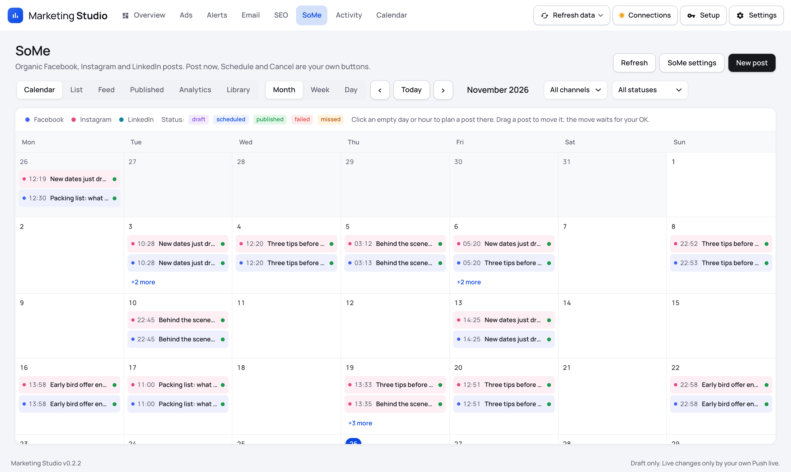

- **Calendar** (month, week, day): Studio posts and what is already live on the Page and Instagram. Click an empty slot to plan a post,
  drag a post to move it (the move waits for your OK).
- **List, Feed, Published, Analytics, Library:** all posts, a feed preview, published posts with insights, and saved templates and hashtag sets.
- **Post editor:** one caption for all channels or one per channel, hashtags, link (with UTM), first comment, media (images, video,
  carousel, reels), alt text, approval, and a phone preview per channel. Checks cover length limits, links and media rules per channel.
- **Post now / Schedule / Cancel / Delete** are your buttons only. Facebook uses Meta's own scheduling. Instagram and LinkedIn can be
  published by Studio's scheduler while the app is open (turn it on in SoMe settings).

---

## Activity

Everything that happened in a period, across channels. Read-only.

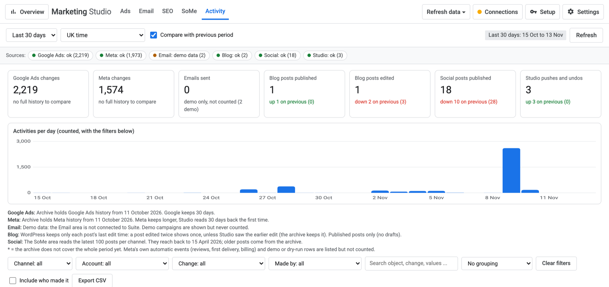

- **Sources:** Google Ads change history, Meta's activity log, emails sent, blog posts published and edited, social posts published,
  and Studio's own pushes and undos.
- Compare with the previous period, a chart per day, and a table you can filter by channel, account, kind of change and who made it,
  group, search and **Export CSV**.
- Google only keeps 30 days of change history, so Studio keeps its own archive. The longer you use it, the further back it goes.
- *Who made it* (staff names) is hidden unless you tick it.

## Calendar

One calendar for every channel, plus the shared library and the copy rules. Works solo; in a team it is shared.

- **Calendar** (week or month): SoMe posts with a time, email campaigns scheduled or sent, and SEO pages with a publish
  time, each in its owner's team colour. Dashed = in review, faded = already out.
- **Clash warnings** when you press Schedule (SoMe, Email): too many posts on a channel in a day, two posts too close
  together, the same link, image or topic within a few days, or an email to the same list or segment within a few days.
  Each warning says who scheduled the other item. Warnings only: you can always go ahead.
- **Library**: approved headlines, calls to action, image URLs, UTM presets and email blocks. In the Ads, Email, SEO and
  SoMe editors, click **Library** next to a text field to insert one. In a team the library syncs like drafts.
- **Team settings**: copy rules (a regular expression, *block* or *warn*, per area), SEO sites, test email addresses, SoMe
  slots / UTM / late posting and the calendar limits. Solo, these are this Mac's own. In a team, an owner or admin can
  share a value with everyone: it then shows as *Set by your team* and is read-only for the others.
- A new install starts with **no copy rules**: add your own. An install from before this version keeps the rules it had.

---

## Keyboard

| Key | In the grid |
|---|---|
| **↓ / ↑** | Next / previous row, the Edit panel follows |
| **Page Down / Page Up** | 10 rows down / up |
| **Home / End** | First / last row |
| **Enter / Esc** | Save / cancel an in-cell edit |
| **Cmd+R** | Reload |

Arrow keys move the text cursor while you are typing in a field. Click a row to go back to moving through rows.

---

## Connections

The **Connections** button checks every connection without changing anything: tokens, access, API versions and when they expire,
rate-limit usage. Each line says how to fix it.

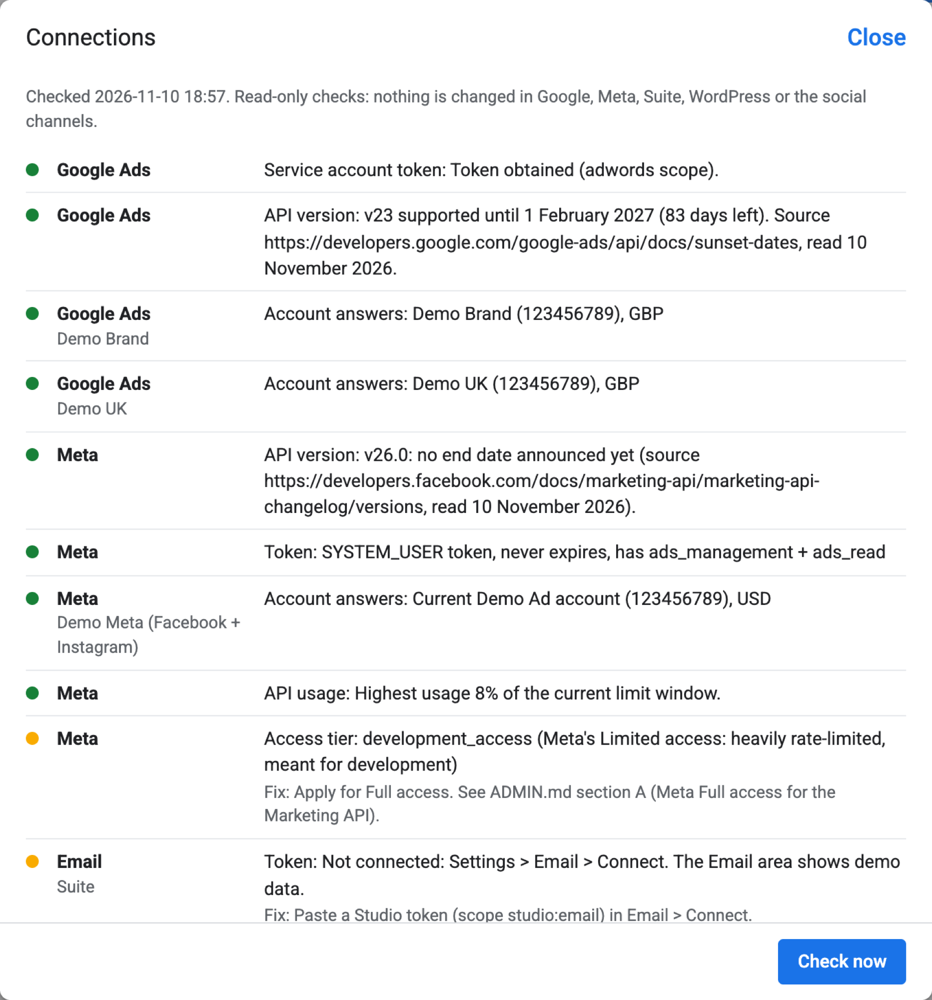

### Meta

| Key | What |
|---|---|
| `META_ACCESS_TOKEN` | A token with `ads_management` (+ `ads_read`). Best: a **system user** token from Business Settings > Users > System users, which does not expire. For posting organic content also `pages_manage_posts`, `pages_read_engagement`, `instagram_content_publish`. |
| `META_AD_ACCOUNT_ID` | `act_` followed by the number. More ad accounts can be added in Settings. |
| `META_PAGE_ID` | The Facebook Page the ads and posts run as (optional) |

Meta apps start with *development access* (low rate limits). Apply for **Full access** to the Marketing API in App Review when you use Studio daily.

### Google Ads

| Key | What |
|---|---|
| `GADS_DEVELOPER_TOKEN` | From the manager account: Tools > API Center |
| `GADS_LOGIN_CUSTOMER_ID` | The manager account (MCC) id, digits only |
| `GADS_OPERATING_CUSTOMER_ID` | The account Studio opens first, digits only |

Studio then lists every account under the manager that your Google user can see.

### Google sign-in

Studio signs in with your own Google user (OAuth, loopback to `127.0.0.1`), so it can do what you can do in Google Ads, and read
Search Console and GA4.

1. In Google Cloud: **APIs & Services > Credentials > Create credentials > OAuth client ID**, type **Desktop app**.
   Enable the *Google Ads API*, *Search Console API* and *Google Analytics Data API* for the project.
2. Put the client id and secret in Setup > **Google sign-in**, save.
3. Press **Sign in with Google**, accept in your browser, go back to the app.

Your team can share one OAuth client; each person signs in with their own Google user. A **service-account key**
(`GOOGLE_SERVICE_ACCOUNT_FILE` in a .env import) also works for Google Ads. When both exist, Ads uses the service account and
Search Console / GA4 use the sign-in.

### Email platform

| Key | What |
|---|---|
| `EMAIL_PLATFORM_NAME` | Your platform's name, shown in buttons (*Save to ...*). Optional |
| `EMAIL_API_URL`, `EMAIL_API_TOKEN` | The platform's [Email API](#email-api-contract) and its bearer token: full access |
| `EMAIL_MCP_URL`, `EMAIL_MCP_TOKEN` | The platform's [MCP server](#mcp-contract) over HTTP and its bearer token: read access + new drafts |
| `EMAIL_FROM_ADDRESS` | Optional: every campaign must use this From and Reply-to (a check). Empty = the platform decides |
| `EMAIL_OWN_DOMAINS` | Optional, comma separated: domains whose addresses may be shown (the From domain is always one) |
| `STUDIO_TEST_EMAIL` | One or more test addresses, comma separated. With one, *Send test* goes there; with several you pick one in a dropdown |
| `EMAIL_TIMEZONE` | Send timezone, IANA name (default `Europe/London`) |
| `EMAIL_IMAGE_HOST` | Optional: warn when an image is not on this host |

Connect in Setup > Email or in the Email area > **Connect** (with *Test connection*).

#### Email API contract

Any email platform can work with Studio by offering this small REST API. All of it lives under `EMAIL_API_URL`, answers JSON,
and takes `Authorization: Bearer <EMAIL_API_TOKEN>`. Actions that send or schedule also carry `X-Studio-Confirm: user-pressed`,
which Studio only sets when you pressed the button.

| Method and path | Body | Answer |
|---|---|---|
| `GET /campaigns?status=&limit=` | | `{"campaigns": [Campaign]}` |
| `GET /campaigns/{id}` | | `{"campaign": Campaign}` (with `html`) |
| `GET /audiences` | | `{"lists": [{id, name, count}], "segments": [{id, name, count}]}` |
| `POST /campaigns` | `{name, subject, html, list_id or segment_id, ...}` | `{"campaign": Campaign}`, always a draft |
| `PATCH /campaigns/{id}` | any of `name, subject, preview_text, html, text, from_name, list_id, segment_id` | `{"campaign": Campaign}` |
| `POST /campaigns/{id}/preview` | | `{"html": "..."}` with merge tags filled with sample data |
| `POST /campaigns/{id}/checks` | | `{"problems": [{level: "error"or"warn", message}]}` |
| `POST /campaigns/{id}/test-send` | `{"to"?: address}` (one of your test addresses; the platform may limit it to internal ones) | `{"ok": true, "to": "..."}` |
| `POST /campaigns/{id}/schedule` | `{"scheduled_for": ISO 8601}` | `{"campaign": Campaign}` (now or later) |
| `POST /campaigns/{id}/cancel` | | `{"campaign": Campaign}` |
| `GET /campaigns/{id}/progress` | | `{"status", "sent", "total"}` while sending |
| `DELETE /campaigns/{id}` | | `{"ok": true, "id"}`. Drafts only; anything else answers 409 |

`Campaign` = `{id, name, subject, preview_text, status (draft, scheduled, sending, sent, cancelled, failed), list_id, list_name,
segment_id, segment_name, scheduled_for, sent_at, from_name, from_address, reply_to, updated_at, stats: {sent, delivered, opens,
clicks, bounces, unsubscribes}}`. Errors: a non-2xx status with `{"error": "message"}`.

#### MCP contract

Studio talks to the platform's MCP server over streamable HTTP (JSON-RPC 2.0, JSON or SSE replies) at `EMAIL_MCP_URL`, with
`Authorization: Bearer <EMAIL_MCP_TOKEN>`, and calls these tools:

| Tool | Used for |
|---|---|
| `email_overview` | Connection check |
| `email_list_campaigns`, `email_get_campaign`, `email_campaign_stats` | The list, the editor, the numbers |
| `email_list_lists`, `email_list_segments`, `email_segment_count` | Audiences |
| `email_create_draft_campaign` | *New campaign* and *Create draft on platform* |

Studio keeps only the fields it needs from each answer and drops any personal data.

#### More platforms

Each connection is a small *provider* class in `engine/areas/email.py` (`EmailApiAdapter`, `McpAdapter`, plus `FakeAdapter`
for demo data). A direct integration for another platform is one more class with the same methods, registered in `PROVIDERS`.

### WordPress

`WP_STUDIO_USER` and `WP_STUDIO_APP_PASSWORD` (Users > Profile > Application passwords). Without them SEO publishing is a dry run.
For the Yoast fields to be writable over the REST API, install `engine/wp-snippets/yoast-rest-fields.php` (staging first).

### LinkedIn

`LINKEDIN_ACCESS_TOKEN` and `LINKEDIN_ORG_URN` (`urn:li:organization:<id>`). Needs a LinkedIn developer app with the Community Management API.

### Import keys from a .env file

Setup > **Import from a .env file**, or the MCP tool `setup_import_env_file`. Studio reads every line it knows, saves secrets to the
Keychain and the rest to `config.json`, and tells you which keys it saved and how many lines it did not use. The file itself is not
kept, and values are never shown.

```sh
# marketing-studio.env
META_ACCESS_TOKEN=EAAG...
META_AD_ACCOUNT_ID=act_1234567890
META_PAGE_ID=1234567890
GADS_DEVELOPER_TOKEN=...
GADS_LOGIN_CUSTOMER_ID=1234567890
GADS_OPERATING_CUSTOMER_ID=1234567890
GOOGLE_CLIENT_ID=....apps.googleusercontent.com
GOOGLE_CLIENT_SECRET=...
GOOGLE_REFRESH_TOKEN=1//...                         # optional: skips Sign in with Google
GOOGLE_SERVICE_ACCOUNT_FILE=~/keys/ads-sa.json      # optional: a service account for Google Ads
EMAIL_PLATFORM_NAME=Acme Mail
EMAIL_API_URL=https://mail.example.com/api/studio/email
EMAIL_API_TOKEN=...
EMAIL_MCP_URL=https://mail.example.com/api/mcp
EMAIL_MCP_TOKEN=...
EMAIL_FROM_ADDRESS=hello@example.com
STUDIO_TEST_EMAIL=you@example.com
WP_STUDIO_USER=...
WP_STUDIO_APP_PASSWORD=...
LINKEDIN_ACCESS_TOKEN=...
LINKEDIN_ORG_URN=urn:li:organization:123
STUDIO_EMAIL_FOLDER=~/Documents/Marketing/email
```

Common other spellings are understood too: `FB_ACCESS_TOKEN`, `GOOGLE_ADS_DEVELOPER_TOKEN`, `GOOGLE_ADS_LOGIN_CUSTOMER_ID`,
`GOOGLE_ADS_CUSTOMER_ID`, `GOOGLE_ADS_CLIENT_ID`, `GOOGLE_ADS_CLIENT_SECRET`, `GOOGLE_ADS_REFRESH_TOKEN`, `GOOGLE_APPLICATION_CREDENTIALS`.

---

## Use with Claude Code (MCP)

Studio ships an MCP server, so Claude Code in your terminal works on **the same accounts and the same draft** as the app. Changes
Claude adds show up in the app straight away, marked *Claude*. Connect it once (Setup shows the exact line, with a Copy button):

```sh
claude mcp add marketing-studio -s user -- python3 "/Applications/Marketing Studio.app/Contents/Resources/engine/mcp_server.py"
```

(If you put the app in `~/Applications`, use that path.) Then, in any Claude Code session:

> *"Which Meta ad sets spent the most last week without results? Pause the worst three in the draft."*
>
> *"Add these 20 negatives to the Brand campaign in the draft and check it."*
>
> *"Set Marketing Studio up from ~/keys/marketing-studio.env."*

Claude **cannot push live, send, publish, schedule or undo**. Those stay your buttons in the app.

### MCP tools

| Area | Tools |
|---|---|
| Setup | `setup_status` (which keys are set, never values), `setup_import_env_file` |
| Accounts and data | `list_accounts`, `list_entities` (any grid, with stats for a period), `find_location`, `data_status`, `refresh_data` |
| Ads draft | `get_draft`, `add_to_draft`, `remove_from_draft`, `check_draft`, `preview_live_push`, `live_push_history`, `send_draft_to_editor` (only after you say so) |
| Email | `email_list_campaigns`, `email_get_campaign`, `email_list_drafts`, `email_add_draft` |
| SEO | `seo_list_posts`, `seo_get_post`, `seo_opportunities`, `seo_list_drafts`, `seo_add_draft` |
| Topical map | `seo_map_get` (nodes, numbers, issues, coverage; filter by state), `seo_map_unmapped`, `seo_map_propose` (changes you accept in Studio), `seo_write_page` (a new page for a node, into the draft) |
| SoMe | `social_calendar`, `social_list_drafts`, `social_add_draft` |
| Activity | `activity_summary`, `activity_rows` (who made each change is always left out) |
| Calendar | `calendar_list`, `library_list`, `team_settings_get` (read only) |

---

## How it works

```
Marketing Studio.app
├── Contents/MacOS/MarketingStudio     Swift: window (WKWebView), menus, starts and stops the engine, one copy at a time
└── Contents/Resources/engine/         Python 3, standard library only
    ├── server.py          HTTP API + the page, on 127.0.0.1:4830
    ├── index.html, static/  the UI (plain JavaScript, no build step)
    ├── appconfig.py       where data and keys live; Keychain; Sign in with Google; .env import
    ├── setup_routes.py    the Setup screen's API
    ├── core.py, gae.py    the Google draft; reading Google Ads Editor's local database
    ├── gapi.py, live.py   Google Ads API: read with stats, preview (validateOnly), push, undo
    ├── meta_ads.py        Meta Marketing API: read, previews, push one change at a time, undo
    ├── overview.py, fx.py the dashboard; display-currency rates (ECB)
    ├── datapolicy.py, datasources.py   when data may be fetched again
    ├── areas/             Email, SEO, SoMe, Activity
    ├── mcp_server.py      the MCP server for Claude (stdio)
    ├── updater.py         in-app updates from GitHub Releases
    └── vendor_hub/        small API clients (Meta Graph, Google Ads REST)
```

When the app starts it runs the engine and waits for it to answer, then shows it. If something already answers on port 4830 as
Marketing Studio (for example the engine run from source), the app uses that instead. Quitting the app stops the engine it started.
The engine log is in `~/Library/Logs/MarketingStudio/engine.log`.

## Where your data lives

| What | Where |
|---|---|
| Secrets (tokens, passwords, Google sign-in) | macOS Keychain, service **Marketing Studio** |
| Other settings (account ids, URLs, folders) | `~/Library/Application Support/MarketingStudio/config.json` |
| Drafts, push history (with undo data), caches, saved views, Meta accounts, SEO and SoMe drafts, activity archive | `~/Library/Application Support/MarketingStudio/data/` |
| Downloaded updates | `~/Library/Application Support/MarketingStudio/updates/` |

The app bundle holds no personal data, and the build refuses to package anything that looks like a key, a setting or a cache.

## Data refresh policy

Studio fetches each source **once** and keeps it until you ask for fresh data: **↻** for the current account, or **Refresh data ▾**
for one source or all of them. Nothing is fetched in the background on a timer, on page load or when you switch tabs. The exceptions:
a period you have never fetched is fetched once, and after **Push live** or **Undo** that account is read again so you see the live values.
The subbar shows when the data you are looking at was fetched.

## Safety rails

- Nothing goes live without **your Push live**. Claude, the MCP server and the draft can never push.
- New campaigns, ad sets and ads are created **paused**.
- Spend increases and permanent removals need an **extra tick** before Push live is enabled.
- Every push stores the values from before it, so **Undo** can put them back.
- Meta: nothing that existed before a push is ever deleted or archived.
- Checks before a push: dead links (blocks), prices and percentages that are not on the linked page, link placement, price formatting.
- The engine answers only on `127.0.0.1`, refuses other hosts and origins, and every change request needs a per-launch secret that only the page gets.

## Privacy

- Studio talks only to Google, Meta, your email platform, WordPress, LinkedIn, the ECB rates API and GitHub (for updates). There is no telemetry.
- It never downloads lead form leads or subscriber lists. Activity hides staff names unless you ask for them.
- Keys never leave your Mac, are never logged, and are never shown again after you save them.

---

## Run from source

```sh
git clone https://github.com/Sivertsen0007/MarketingStudio.git
cd MarketingStudio/engine
python3 server.py                  # http://localhost:4830, opens your browser (--no-open to skip, --port N)
```

From source the engine uses the same Keychain and data folder as the app. Point it somewhere else with `MSTUDIO_HOME=/tmp/studio`,
and keep secrets in a file instead of the Keychain with `MSTUDIO_KEYCHAIN=0`.

## Tests

Plain `python3`, no pytest. Each file runs on its own and never touches the real Keychain or data folder:

```sh
cd engine
for t in tests/test_*.py; do python3 "$t"; done
```

## Build the app

```sh
cd macapp
./make-signing-cert.sh      # once: a local code-signing certificate, so macOS keeps permissions between builds
./build.sh                  # -> macapp/build/Marketing Studio.app
./build.sh --install        # also put it in ~/Applications (quits a running copy first)
```

`MSTUDIO_SIGN_ID` picks another signing identity. `MSTUDIO_PORT` runs the app on another port, `MSTUDIO_ENGINE_DIR` runs it with an engine from another folder.

## Release

```sh
./release.sh patch --notes notes.md     # or minor / major / X.Y.Z; --dry-run builds without publishing
```

It bumps `VERSION`, builds and signs the app, zips it, tags, pushes and publishes a GitHub release. Every installed copy then offers
the update. Releases must be signed on the Mac that holds the signing certificate: installed copies only accept an update signed
with the same certificate as themselves.

## Repository layout

```
engine/        the Python engine and the UI (see How it works)
engine/tests/  tests
macapp/        the Swift app, its build script and icon
docs/          screenshots
release.sh     cut a release
VERSION        the version, stamped into the app at build time
```

## Troubleshooting

| Problem | Fix |
|---|---|
| "can't be opened because Apple cannot check it" | Right-click > Open, or System Settings > Privacy & Security > Open Anyway |
| "Port 4830 is already used by another program" | Quit what uses it (`lsof -iTCP:4830 -sTCP:LISTEN`), or start the app with `MSTUDIO_PORT=4831` |
| Blank grid, "... is not set. Open Setup" | Fill in that block in Setup, then **Refresh data** |
| Google: "Not signed in to Google" | Setup > Sign in with Google (needs the OAuth client id and secret first) |
| Google sign-in gives no refresh token | Remove Marketing Studio at myaccount.google.com/permissions and sign in again |
| Meta: rate-limit errors (#4, #17, #613) | Wait a minute; Studio already retries. Apply for Full access in Meta App Review |
| Numbers look old | Studio keeps data until you refresh: **↻** or **Refresh data ▾** |
| Update says it can't install | Your copy was built and signed elsewhere: download the latest release and replace the app once |
| Something else | Look in `~/Library/Logs/MarketingStudio/engine.log`, and **Connections** for a health check |

## License

[MIT](LICENSE). Use it, copy it, change it, build on it, share it, also commercially. Keep the copyright notice in copies.
